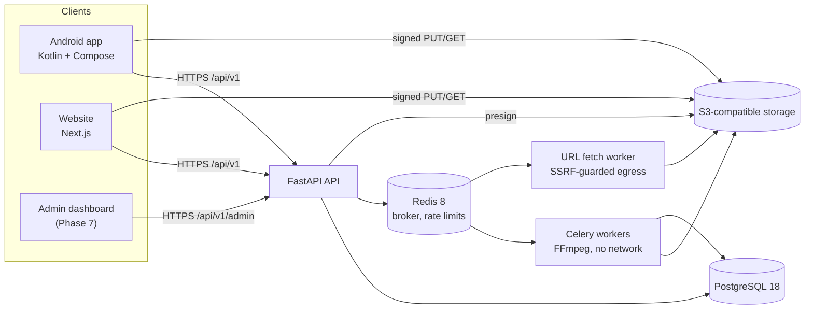

# MediaVault architecture

Backend first: one FastAPI service is the single source of truth for Android, web and (later) admin.

## Phase 1 scope (this commit)

| Piece | Implementation |
| --- | --- |
| `GET /api/v1/health` | `backend/app/api/v1/health.py`. Runs `SELECT 1` with a timeout. Returns 200 `ok` or 503 `degraded`, and never leaks connection details |
| Database | Async SQLAlchemy 2.1 engine on psycopg 3 (`backend/app/db/session.py`), Alembic baseline `0001_baseline` (enables `citext`) |
| Security | Strict CORS allow-list from env (https-only, no wildcard in staging/production), required `DATABASE_URL` in staging/production, security headers middleware, `/docs` and `/openapi.json` disabled in production |
| Web | `web/src/components/HealthStatus.tsx` (TanStack Query + Zod) on the home page. Base URL from `NEXT_PUBLIC_API_BASE_URL` |
| Android | Retrofit 3 + OkHttp 5 + kotlinx.serialization → `NetworkHealthRepository` → `HomeViewModel` (StateFlow) → Compose `HomeScreen`. Base URL from `BuildConfig.API_BASE_URL` (`10.0.2.2` in debug) |
| Local infra | `infrastructure/docker/compose.dev.yml`: Postgres 18.6, Redis 8.10.3, SeaweedFS 4.53 (S3). All bound to 127.0.0.1 |

## Phase 2 step 1: accounts, login, ownership

| Piece | Implementation |
| --- | --- |
| Schema (`0002_auth`) | `users` (UUID, `citext` unique email, argon2id hash, `is_active`), `auth_sessions` (expiry, revocation reason), `refresh_tokens` (sha256 only, single use), `media_items` **stub** (owner + title, no files) |
| Tokens | HS256 access JWT, 15 min, claims `iss`, `aud`, `sub`, `sid`, `typ`, `iat`, `exp`, `jti`. Every request also checks the server-side session, so logout and reuse revocation apply immediately. Refresh tokens are opaque 256-bit values, rotated on every use (row locked `FOR UPDATE`); presenting a used one revokes the session |
| Secrets | `JWT_SECRET` from env only. Development/test fall back to a clearly named dev value; staging/production refuse to start without a 32+ character non-default secret |
| Abuse | Generic errors, dummy argon2 verify for unknown emails, constant register response, in-memory fixed-window limits per IP and per email (per process; Redis later) |
| Ownership | `CurrentUser` dependency; every `media_items` query filters on `owner_id`, so other users' rows are indistinguishable from missing ones (404) |
| Web | Backend-for-frontend: `src/app/api/auth/*` route handlers call the API server-side and store tokens only in `HttpOnly; SameSite=Strict; Secure` cookies (`mv_refresh` scoped to `/api/auth`). State-changing routes require a same-origin `Origin` header |
| Android | `NetworkAuthRepository` + `EncryptedTokenStore`: DataStore holding Tink AES-256-GCM ciphertext; the Tink keyset is wrapped by an Android Keystore key. Backups are disabled. (EncryptedSharedPreferences is deprecated, so it isn't used) |

## Key decisions

* **Retrofit 3.0.0 with OkHttp 5.5.1.** Retrofit 3.0.0's POM declares OkHttp 4.12.0. Gradle resolves it
  to 5.5.1 (`dependencyInsight`), the app builds, and MockWebServer tests plus a test against the
  live backend pass through the real Retrofit/OkHttp 5 stack. The two work together.
* **compileSdk 37, targetSdk 36.** Compose BOM 2026.09.00, core-ktx 1.19.1 and OkHttp 5.5.1
  all require compiling against API 37. targetSdk stays 36, which Google Play requires for new apps,
  until Android 17 behavior changes have been tested.
* **No Hilt yet.** Phase 1 uses a small manual `AppContainer`. Hilt comes in when there is more to inject.
* **SeaweedFS rather than MinIO** for local S3, because MinIO community images are no longer published or maintained.
* **No on-device FFmpeg.** ffmpeg-kit was retired. On-device edits will use Media3 Transformer, and
  heavier jobs will run FFmpeg on the server.
* **Ads come later (Phase 6).** Google UMP consent is collected before any AdMob request, using test ad IDs
  until production.
